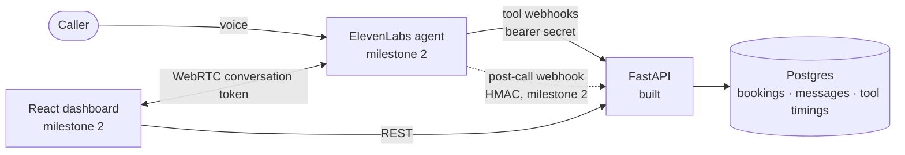

# Maître D

A voice agent that answers the phone for **Saffron Table**, a fictional restaurant in London, and
books the table.

Speech is fuzzy; bookings are not. A caller says "next Friday around eight", and by the time that
reaches a database it has to be a specific instant in Europe/London, for a specific table and a
specific guest — and it must not collide with another call that arrived at the same moment and said
the same thing.

Maître D is the backend for that agent. It owns the booking rules, exposes them to an ElevenLabs
voice agent as server tools, and leaves the guarantee that no table is ever booked twice to
Postgres, where a constraint can enforce it.

> **Status: milestone 1 of 3.** The booking domain, its database guarantees and the server-tool
> endpoints are built and tested. The ElevenLabs agent, post-call webhook and dashboard are next.
> There is no hosted demo.

Built with Python 3.12, FastAPI, Pydantic v2, SQLAlchemy 2 (async), Alembic and PostgreSQL 17.

## How it fits together



The division of labour is deliberate:

- **The model does language.** It turns "next Friday around eight" into a local date, the weekday
  the caller said, a local time, a name and a phone number.
- **Python does the calendar.** It cross-checks the weekday, localises the time with `zoneinfo`,
  validates opening hours, and stores a UTC instant.
- **Postgres owns concurrency.** The database refuses overlapping confirmed bookings, no matter
  how many callers arrive at once or what code path they use.
- **Every reply carries a sentence the agent can say.** Errors are caller-facing speech, with
  alternatives, not stack traces.

## The hard problems

### No double-booking, even under a race

The central guarantee is a PostgreSQL exclusion constraint on `bookings`:

```sql
CONSTRAINT bookings_no_overlap EXCLUDE USING gist (
    table_id WITH =,
    tstzrange(starts_at, ends_at, '[)') WITH &&
) WHERE (status = 'confirmed')
```

A Python availability check alone cannot survive two requests that both see the last table free and
both try to take it. The constraint holds for every writer, including ones that don't exist yet. The
half-open `[)` ranges let back-to-back sittings share a table, and the `WHERE` clause means a
cancelled booking frees its table without being deleted.

Booking writes for the same local day also take a short advisory lock. That is about **latency, not
correctness**: simultaneous clashing inserts can deadlock inside Postgres's exclusion check, and each
deadlock costs about a second to resolve. The queue removes that pause without re-reading
availability, so the constraint still decides who gets the table.

The tests prove the point in three ways: a raw SQL overlapping insert fails with `23P01`; eight
concurrent `create_booking` callers for a slot with four fitting tables produce exactly four
bookings and four `slot_taken` replies; and a control test drops the constraint and shows the same
race double-booking.

### A retried request is still one booking

A tool call can arrive twice because the model called it twice, or because the platform retried a
request that timed out. Either way, `create_booking` must not create a second table booking.

Each `create_booking` insert carries an idempotency key:

```
sha256(conversation_id + date + time + party_size + normalised name + E.164 phone)
```

When the agent calls a tool, the conversation ID comes from the platform
(`system__conversation_id`), not from the model, so a retry necessarily carries the same one. The
key has a `UNIQUE` constraint. A duplicate that arrives while the first request is still running
loses on that constraint, reads the winner's row, and returns the same booking with the same
reference.

The key leaves out `notes`, because a retrying model may reword them. It also can't be the only
check: if a caller corrects "eight" to "half seven" in the same call, the model might see that as a
new booking. A separate same-day rule answers `already_booked_this_call` with the current booking,
so the correction becomes a change rather than a second table.

### A spoken time is not a timestamp

The agent supplies a London date, the weekday the caller actually said, and a local time. The
backend:

1. **Cross-checks the weekday against the date.** If the caller said Friday and the model supplied
   a Thursday, the reply asks which one was meant. Models make calendar-arithmetic mistakes; this
   catches the common "next Friday" off-by-one.
2. **Localises with `zoneinfo`.** Never by adding a fixed offset. 19:00 on 29 March 2026 is 18:00
   UTC; 19:00 on 25 October 2026 is 19:00 UTC.
3. **Builds slot grids in wall-clock time, then converts.** Stepping UTC instants across a clock
   change would shift every local slot by an hour.
4. **Computes "today" in London.** At 00:30 on a summer night in London it is still yesterday in
   UTC.
5. **Rejects times the clocks skip or repeat** rather than quietly picking one.

Everything stored in Postgres is a UTC instant. Local time exists only at the edges: what the
caller said, and what the agent says back.

### A pause is a failed conversation

Voice callers notice silence. Tool latency is measured with ASGI middleware around every
`/tools/*` request, from when the request reaches the app to the last byte of the response. The
`tool_invocations` row is written **after** the response has been sent, so logging is not in the
caller's pause.

A local baseline from M1, measured on a Windows 11 dev laptop with Postgres 17.11 on localhost and
one uvicorn worker, 200 sequential booking lifecycles after 10 warm-up rounds (2026-10-25):

| Tool | Server p50 / p95 (ms) | Client p50 / p95 (ms) |
|---|---:|---:|
| `check_availability` | 2.3 / 2.9 | 5.9 / 7.7 |
| `create_booking` | 5.3 / 7.1 | 9.0 / 11.6 |
| `find_booking` | 2.2 / 3.4 | 5.9 / 8.4 |
| `change_booking` | 5.7 / 7.4 | 9.5 / 12.2 |
| `cancel_booking` | 4.2 / 5.6 | 8.0 / 10.5 |

These are local numbers, not the round trip ElevenLabs will see through a tunnel. The dashboard will
show both: the platform's `tool_latency_secs` and the server's own measurement, so network and
platform overhead are visible separately.

### Only the right caller sees a booking

- Tool requests require a bearer secret, compared in constant time. With no secret configured, the
  endpoints fail closed with a 500 rather than accepting an empty token.
- `find_booking`, `change_booking` and `cancel_booking` require the **name and phone to match**. A
  wrong name with the right phone gets exactly the same `not_found` as no booking at all. The tool
  is not an oracle for "is there a booking on this number".
- A booking reference on its own authorises nothing, so an injected "cancel booking K7M2QX" fails
  without the matching name and phone.
- Phone numbers are normalised to E.164 with the UK as the default region. Names match by words,
  ignoring case, accents, punctuation and titles.
- Anything a caller said — names, phone numbers, messages, transcripts — is logged at `DEBUG`.
  `INFO` carries the tool name, outcome and timing only.

The post-call webhook will be HMAC-verified over the raw body bytes, with a timestamp window, before
any JSON is parsed.

## The tool API

The backend exposes six server tools, one `POST` per tool, with the path equal to the tool name.

| Tool | What it does |
|---|---|
| `check_availability` | Reports whether a slot is free, or the nearest alternatives |
| `create_booking` | Books a table and returns a short reference |
| `find_booking` | Lists a caller's upcoming bookings, after name and phone match |
| `change_booking` | Moves or resizes a booking |
| `cancel_booking` | Cancels a booking |
| `take_message` | Records a message for the events team |

Requests carry `Authorization: Bearer <secret>` and a `conversation_id`. In the agent config,
`conversation_id` will be bound to the platform's dynamic variable, so the model never fills it.
Business outcomes — a full slot, a missing booking, a bad date — return **HTTP 200**, because the
agent needs to read our sentence rather than interpret a status code:

```json
{
  "ok": false,
  "error": "slot_taken",
  "say": "Sorry, the last table for 4 on Friday 30 October at 8 pm has just gone. I can offer 7:30 pm or 8:45 pm that day.",
  "alternatives": [
    { "date": "2026-10-30", "time": "19:30", "spoken": "Friday 30 October at 7:30 pm" },
    { "date": "2026-10-30", "time": "20:45", "spoken": "Friday 30 October at 8:45 pm" }
  ]
}
```

`say` is read aloud. `detail` is optional guidance for the model and is never spoken. Only a bad
token (401) or a bug (500) is non-2xx. Request-schema failures also return 200, with a generic
caller-facing sentence and the field hints in `detail`.

## Run it locally

Prerequisites: [uv](https://docs.astral.sh/uv/) and PostgreSQL 17 (Docker Compose is included). No
Node.js is needed yet; the frontend arrives in milestone 2.

From the repository root:

```bash
# 1. Configuration. Never commit .env.
cp .env.example .env
uv run python -c "import secrets; print(secrets.token_urlsafe(32))"
# Paste the output into TOOL_BEARER_SECRET in .env.

# 2. Postgres. Or point DATABASE_URL and TEST_DATABASE_URL at any Postgres 17 server whose
#    role already exists and can create databases.
docker compose up -d --wait
uv sync

# 3. Schema and demo data. create_databases.py is safe to re-run.
uv run python scripts/create_databases.py
uv run alembic upgrade head
uv run python scripts/seed.py --demo

# 4. Start the API.
uv run uvicorn maitre_d.main:create_app --factory --reload --port 8000
```

Check it is up:

```bash
curl http://localhost:8000/api/health
```

A tool call looks like this. Replace the bearer value with the secret in `.env`, and use a future
date that is really that weekday; Saffron Table is closed on Mondays. This example uses Friday
6 November 2026.

```bash
curl -s http://localhost:8000/tools/check_availability \
  -H "Authorization: Bearer <the value of TOOL_BEARER_SECRET in .env>" \
  -H "Content-Type: application/json" \
  -d '{
    "conversation_id": "local-demo",
    "date": "2026-11-06",
    "weekday": "Friday",
    "time": "20:00",
    "party_size": 2
  }'
```

Without `TOOL_BEARER_SECRET`, every tool deliberately returns 500.

## Tests and checks

The booking tests run against real PostgreSQL, because the guarantees under test live in the
database. The suite rebuilds `TEST_DATABASE_URL` from the actual Alembic migrations, then truncates
between tests. `uv run pytest` drops and recreates the `public` schema in that database — never point
`TEST_DATABASE_URL` at data you care about.

```bash
uv run python scripts/create_databases.py   # first run only
uv run pytest
uv run ruff check . && uv run ruff format --check . && uv run mypy
uv run alembic check                        # models and migrations agree
```

At the time of writing, the suite is **104 tests**, all passing (5.65 s on the Windows 11 dev laptop
against local Postgres 17.11, 2026-10-30). Coverage includes the concurrent race, the raw-SQL
constraint check, idempotent retries, DST edge cases, name-and-phone access control, and the HTTP
contract including schema failures.

To measure tool latency against a running server:

```bash
uv run python scripts/bench_tools.py --base-url http://localhost:8000 --rounds 200
```

It runs a booking lifecycle per round, prints client and server p50/p95, and deletes the rows it
creates.

## Where to look

```
src/maitre_d/
  main.py            create_app(): middleware, routers, validation handling
  config.py          settings from the environment and .env
  db.py              async engine, session helpers, dining-table sync
  models.py          SQLAlchemy tables mirroring the migration
  restaurant.py      Saffron Table's facts: hours, tables, timezone
  timeslots.py       wall-clock time to UTC, DST-safe validation, slot grid
  bookings.py        availability, alternatives, and each booking tool
  speech.py          every caller-facing sentence
  schemas.py         the request/response contract with the agent
  security.py        tool bearer authentication
  invocations.py     latency middleware for /tools/*
  routes/tools.py    the six server tools
migrations/          Alembic; 0001 is the booking domain
tests/               pytest against real Postgres
scripts/             create_databases, seed, bench
docs/                plan.md and decisions.md
```

## Roadmap

| Milestone | State | Contents |
|---|---|---|
| **M1 · Booking domain** | done | Schema and constraint, availability and alternatives, booking tools, auth, latency logging, tests |
| **M2 · Live agent** | next | Agent config as code, knowledge base, `/api/session`, post-call HMAC webhook, React dashboard, first real calls |
| **M3 · Evals and CI** | later | ElevenLabs agent tests, GitHub Actions, demo recording |

The project deliberately has no public deployment. The ElevenLabs account is on the Free plan (15
voice minutes a month, no overage), so a public "Talk to the agent" button would let one visitor
spend the month's minutes. The backend, the tests and the recorded demo are the deliverable; anyone
can run the rest locally with their own key.

Also out of scope for now: phone numbers via Twilio, multilingual calls, SMS/email confirmations,
combining tables for large parties, and payments.

## Documentation

- [`docs/plan.md`](docs/plan.md) — architecture, data model, tool contract and milestones
- [`docs/decisions.md`](docs/decisions.md) — why the system is built this way, with alternatives
  considered
- [`CLAUDE.md`](CLAUDE.md) — working conventions and invariants for this repository

## A note on the data

Saffron Table, its menu, its staff and every guest are fictional. Phone numbers use the
07700 900000–900999 range that Ofcom reserves for drama, so nothing here can reach a real person.
