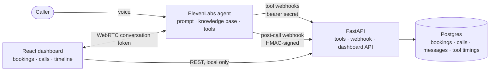
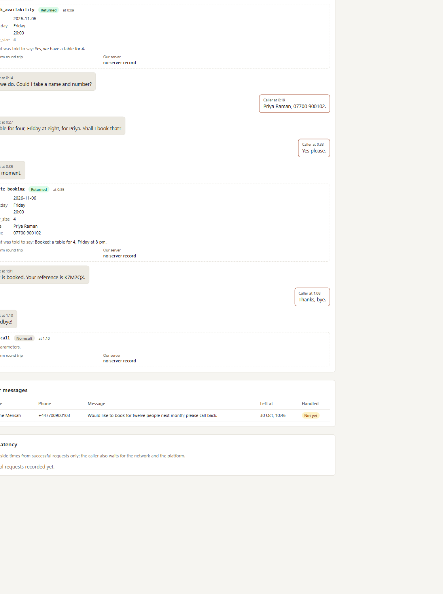
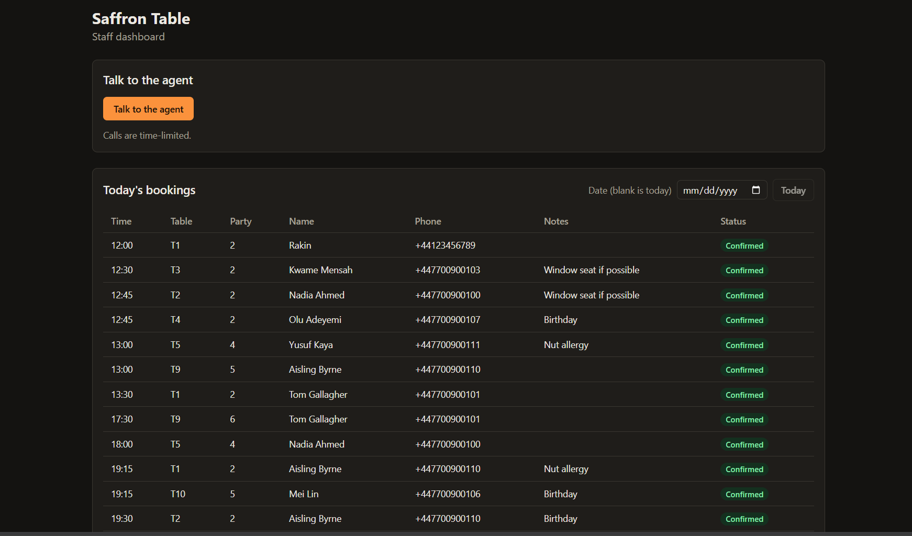

# Maître D

A voice agent that answers the phone for **Saffron Table**, a fictional restaurant in London, and
books the table.

Speech is fuzzy; bookings are not. A caller says "next Friday around eight", and by the time that
reaches a database it has to be a specific instant in Europe/London, for a specific table and a
specific guest — and it must not collide with another call that arrived at the same moment and said
the same thing.

Maître D is the backend for that agent. It owns the booking rules, exposes them to an ElevenLabs
voice agent as server tools, and leaves the guarantee that no table is ever booked twice to
Postgres, where a constraint can enforce it.

> **Status: built, tested, and exercised by real calls.** The backend, the dashboard, the agent's
> configuration and the evals are all in this repository and covered by tests. On 2026-11-03
> three voice calls were made from the dashboard's Talk button through a tunnel to a laptop. The
> first booked a table end to end: the tools were reached with the right bearer, the booking is in
> Postgres, and the post-call webhook arrived signed and was stored. The other two ended when the
> caller closed the page, and the platform's analysis marked them unresolved. The agent tests have
> still never been run. Every number below says what it was measured on, and the live ones come
> from a handful of tool requests, so they are samples, not percentiles. [Known gaps](#known-gaps) lists the rest.
> There is no hosted demo, on purpose (see [Run it with a voice agent](#run-it-with-a-voice-agent)).

Built with Python 3.12, FastAPI, Pydantic v2, SQLAlchemy 2 (async), Alembic and PostgreSQL 17 on the
backend, and React, TypeScript (strict), Vite and TanStack Query on the dashboard.

## How it fits together



The division of labour is deliberate:

- **The model does language.** It turns "next Friday around eight" into a local date, the weekday
  the caller said, a local time, a name and a phone number.
- **Python does the calendar.** It cross-checks the weekday, localises the time with `zoneinfo`,
  validates opening hours, and stores a UTC instant.
- **Postgres owns concurrency.** The database refuses overlapping confirmed bookings, no matter
  how many callers arrive at once or what code path they use.
- **Every reply carries a sentence the agent can say.** Errors are caller-facing speech, with
  alternatives, not stack traces.

## The hard problems

### No double-booking, even under a race

The central guarantee is a PostgreSQL exclusion constraint on `bookings`:

```sql
CONSTRAINT bookings_no_overlap EXCLUDE USING gist (
    table_id WITH =,
    tstzrange(starts_at, ends_at, '[)') WITH &&
) WHERE (status = 'confirmed')
```

A Python availability check alone cannot survive two requests that both see the last table free and
both try to take it. The constraint holds for every writer, including ones that don't exist yet. The
half-open `[)` ranges let back-to-back sittings share a table, and the `WHERE` clause means a
cancelled booking frees its table without being deleted.

Booking writes for the same local day also take a short advisory lock. That is about **latency, not
correctness**: simultaneous clashing inserts can deadlock inside Postgres's exclusion check, and each
deadlock costs about a second to resolve. The queue removes that pause without re-reading
availability, so the constraint still decides who gets the table.

The tests prove the point in three ways: a raw SQL overlapping insert fails with `23P01`; eight
concurrent `create_booking` callers for a slot with four fitting tables produce exactly four
bookings and four `slot_taken` replies; and a control test drops the constraint and shows the same
race double-booking.

### A retried request is still one booking

A tool call can arrive twice because the model called it twice, or because the platform retried a
request that timed out. Either way, `create_booking` must not create a second table booking.

Each `create_booking` insert carries an idempotency key:

```
sha256(conversation_id + date + time + party_size + normalised name + E.164 phone)
```

When the agent calls a tool, the conversation ID comes from the platform
(`system__conversation_id`), not from the model, so a retry necessarily carries the same one. The
key has a `UNIQUE` constraint. A duplicate that arrives while the first request is still running
loses on that constraint, reads the winner's row, and returns the same booking with the same
reference.

This happened for real in the first live call. The caller said "yes" while `create_booking` was
running, and the platform recorded the tool call as "abandoned due to user input" with no result,
although our server had already received it. The agent then called the tool twice more. The log
holds three identical requests, each answered `ok` with the same reference, and the database holds
one booking under one idempotency key.

The key leaves out `notes`, because a retrying model may reword them. It also can't be the only
check: if a caller corrects "eight" to "half seven" in the same call, the model might see that as a
new booking. A separate same-day rule answers `already_booked_this_call` with the current booking,
so the correction becomes a change rather than a second table.

### A spoken time is not a timestamp

The agent supplies a London date, the weekday the caller actually said, and a local time. The
backend:

1. **Cross-checks the weekday against the date.** If the caller said Friday and the model supplied
   a Thursday, the reply asks which one was meant. Models make calendar-arithmetic mistakes; this
   catches the common "next Friday" off-by-one.
2. **Localises with `zoneinfo`.** Never by adding a fixed offset. 19:00 on 29 March 2026 is 18:00
   UTC; 19:00 on 25 October 2026 is 19:00 UTC.
3. **Builds slot grids in wall-clock time, then converts.** Stepping UTC instants across a clock
   change would shift every local slot by an hour.
4. **Computes "today" in London.** At 00:30 on a summer night in London it is still yesterday in
   UTC.
5. **Rejects times the clocks skip or repeat** rather than quietly picking one.

Everything stored in Postgres is a UTC instant. Local time exists only at the edges: what the
caller said, and what the agent says back.

### A pause is a failed conversation

Voice callers notice silence. Tool latency is measured with ASGI middleware around every
`/tools/*` request, from when the request reaches the app to the last byte of the response. The
`tool_invocations` row is written **after** the response has been sent, so logging is not in the
caller's pause.

A local baseline from M1, measured on a Windows 11 dev laptop with Postgres 17.11 on localhost and
one uvicorn worker, 200 sequential booking lifecycles after 10 warm-up rounds (2026-10-25):

| Tool | Server p50 / p95 (ms) | Client p50 / p95 (ms) |
|---|---:|---:|
| `check_availability` | 2.3 / 2.9 | 5.9 / 7.7 |
| `create_booking` | 5.3 / 7.1 | 9.0 / 11.6 |
| `find_booking` | 2.2 / 3.4 | 5.9 / 8.4 |
| `change_booking` | 5.7 / 7.4 | 9.5 / 12.2 |
| `cancel_booking` | 4.2 / 5.6 | 8.0 / 10.5 |

Those are local numbers, not the round trip ElevenLabs sees. The first live call gives one sample of
that. Conditions: 2026-11-03, one 134 s call started from the dashboard's Talk button, the agent on
`gemini-2.5-flash`, this laptop reached through a Cloudflare quick tunnel, the ElevenLabs Free
plan. Three tool requests completed (the platform's `tool_latency_secs` is the time
the platform waited; the server figure is our own middleware's, for the same request):

| Tool request | Platform `tool_latency_secs` | Our server time |
|---|---:|---:|
| `check_availability` | 0.63 s | 3.8 ms |
| `create_booking` (first completed reply) | 0.45 s | 4.7 ms |
| `create_booking` (second completed reply) | 0.52 s | 4.1 ms |

So about half a second of what the platform waited for was the network and the platform itself, not
our handler. The platform also reported the model taking 0.79 to 1.12 s to write a tool request
(`convai_llm_tool_request_generation_latency`, six samples) and 0.36 to 1.34 s to start answering
(`convai_llm_service_ttfb`, sixteen samples), which is larger than anything on our side. Three tool
calls are not a distribution: there are no percentiles for the live path, and repeating the call on
another network would give different numbers. The call timeline in the dashboard shows both
measurements for each tool call.

### Only the right caller sees a booking

- Tool requests require a bearer secret, compared in constant time. With no secret configured, the
  endpoints fail closed with a 500 rather than accepting an empty token.
- `find_booking`, `change_booking` and `cancel_booking` require the **name and phone to match**. A
  wrong name with the right phone gets exactly the same `not_found` as no booking at all. The tool
  is not an oracle for "is there a booking on this number".
- A booking reference on its own authorises nothing, so an injected "cancel booking K7M2QX" fails
  without the matching name and phone.
- Phone numbers are normalised to E.164 with the UK as the default region. Names match by words,
  ignoring case, accents, punctuation and titles.
- Anything a caller said — names, phone numbers, messages, transcripts — is logged at `DEBUG`.
  `INFO` carries the tool name, outcome and timing only. This is tested for the webhook and the
  session route, and a failed database write used to break it: the error text quoted the whole
  request. That was reproduced by a test, then fixed (`hide_parameters`).
- **The post-call webhook is verified before it is parsed.** The signature is an HMAC over the raw
  body bytes, compared in constant time, with a timestamp window on both sides (the platform's own
  SDK helper checks only the past side and compares with `!=`). The body is read with a size cap
  first, and every failure gets the same 401. A transcript is stored with each tool call's request
  headers removed, because they can carry the bearer token.
- **A tunnel publishes the whole app, so what has no login refuses it.** `/api/session` (which spends
  voice minutes) and the dashboard routes (which list guests' names and numbers) answer 403 to any
  request that came through a proxy, from another machine, with a `Host` other than localhost
  (which stops DNS rebinding from a web page the operator has open), or that the browser labels
  cross-site. The tools and the webhook stay
  reachable: each has its own secret. Strangers can't grow the timing table either: only requests
  the app answered are stored, and bodies over 64 KB are refused unread.
- The browser gets a short-lived conversation token. The ElevenLabs API key never leaves the
  server, and a test asserts the session response can't hold it.

## The dashboard

One page, served by the backend or by Vite in development: today's bookings (London day, with
cancelled ones marked), recent calls, messages left for staff, per-tool p50/p95, and a **Talk to the
agent** button. Opening a call shows its timeline: the transcript interleaved with each tool call,
the arguments, the sentence the agent was given, and two latency figures side by side, the
platform's round trip and our server's time. The merge is a pure, unit-tested function
(`frontend/src/lib/timeline.ts`).



*A seeded demo call: fictional data, and no timings, because nothing was measured. The latency
columns say so rather than show a made-up number.* The frontend's types are generated from the
backend's OpenAPI document, and CI fails if the committed copy has drifted.



*The dashboard on 2026-11-03, after the live calls. The 12:00 booking for two on T1 at the top was
made by voice through the Talk button; every other row is seeded demo data.*

The "Talk" button is typechecked and linted, and it has started three real calls (2026-11-03). No
automated test covers it, because a call needs a live agent and spends voice minutes.

## The agent and its evals

The agent is configured as code under `agent/`:

- **The prompt** is Markdown (`agent/prompts/`), embedded into the config by a script, with a test
  that fails if they differ, because a prompt inside a JSON string can't be reviewed in a diff.
- **Six tool configs**, one JSON file each. A test reads them and fails if a tool's body drifts from
  the Pydantic model its route parses. `conversation_id` is bound to the platform's system variable,
  so the model can't choose it; a test pins that for every tool.
- **A knowledge base** of two pages: a hand-written menu with the UK's 14 allergens per dish, and a
  page of hours and rules **generated from `restaurant.py`**, so the agent can't promise a time the
  backend would refuse. The prompt is tested not to repeat those facts.
- **Limits** that protect a Free plan: authentication required, a call cap, a silence timeout, one
  concurrent call, a daily conversation limit, and no bursting (which is billed at double).

Five **agent tests** are defined in `agent/test_configs/`: the weekday/time/party-size assertion for
"next Friday around eight", a full slot, an allergen question, someone else's booking, and a prompt
injection. Simulations use mocked tool replies, so they don't depend on the database. They are shape-
tested, and **have never been run**. Running one spends credits the platform doesn't document, so
`scripts/run_agent_tests.py` refuses without `--confirm-spend` and prints the `credits_used` each run
reports; run one, read the figure, then decide.

## The tool API

The backend exposes six server tools, one `POST` per tool, with the path equal to the tool name.

| Tool | What it does |
|---|---|
| `check_availability` | Reports whether a slot is free, or the nearest alternatives |
| `create_booking` | Books a table and returns a short reference |
| `find_booking` | Lists a caller's upcoming bookings, after name and phone match |
| `change_booking` | Moves or resizes a booking |
| `cancel_booking` | Cancels a booking |
| `take_message` | Records a message for the events team |

Requests carry `Authorization: Bearer <secret>` and a `conversation_id`. In the agent config,
`conversation_id` is bound to the platform's dynamic variable, so the model never fills it.
Business outcomes — a full slot, a missing booking, a bad date — return **HTTP 200**, because the
agent needs to read our sentence rather than interpret a status code:

```json
{
  "ok": false,
  "error": "slot_taken",
  "say": "Sorry, the last table for 4 on Friday 30 October at 8 pm has just gone. I can offer 7:30 pm or 8:45 pm that day.",
  "alternatives": [
    { "date": "2026-10-30", "time": "19:30", "spoken": "Friday 30 October at 7:30 pm" },
    { "date": "2026-10-30", "time": "20:45", "spoken": "Friday 30 October at 8:45 pm" }
  ]
}
```

`say` is read aloud. `detail` is optional guidance for the model and is never spoken. Only a bad
token (401) or a bug (500) is non-2xx. Request-schema failures also return 200, with a generic
caller-facing sentence and the field hints in `detail`.

## Run it locally

Prerequisites: [uv](https://docs.astral.sh/uv/), Node.js 24 and PostgreSQL 17 (Docker Compose is
included). This part needs no ElevenLabs account.

From the repository root:

```bash
# 1. Configuration. Never commit .env.
cp .env.example .env
uv run python -c "import secrets; print(secrets.token_urlsafe(32))"
# Paste the output into TOOL_BEARER_SECRET in .env.

# 2. Postgres. Or point DATABASE_URL and TEST_DATABASE_URL at any Postgres 17 server whose
#    role already exists and can create databases.
docker compose up -d --wait
uv sync

# 3. Schema and demo data (a week of bookings and two fictional calls). Safe to re-run.
uv run python scripts/create_databases.py
uv run alembic upgrade head
uv run python scripts/seed.py --demo

# 4. Start the API, then the dashboard.
uv run uvicorn maitre_d.main:create_app --factory --reload --port 8000
cd frontend && npm ci && npm run dev        # http://localhost:5173
```

Check it is up with `curl http://localhost:8000/api/health`. A tool call looks like this. Replace
the bearer value with the secret in `.env`, and use a future date that is really that weekday;
Saffron Table is closed on Mondays. This example uses Friday 6 November 2026.

```bash
curl -s http://localhost:8000/tools/check_availability \
  -H "Authorization: Bearer <the value of TOOL_BEARER_SECRET in .env>" \
  -H "Content-Type: application/json" \
  -d '{
    "conversation_id": "local-demo",
    "date": "2026-11-06",
    "weekday": "Friday",
    "time": "20:00",
    "party_size": 2
  }'
```

Without `TOOL_BEARER_SECRET`, every tool deliberately returns 500. To serve the dashboard from the
backend instead of Vite, run `npm run build` in `frontend/` and open http://localhost:8000.

## Run it with a voice agent

You need an ElevenLabs account and API key (the **Free plan** works: 15 voice minutes a month, no
overage) and a way to give ElevenLabs a public address for your backend, such as a Cloudflare quick
tunnel. Put `ELEVENLABS_API_KEY` in `.env`, then:

```bash
# Creates or updates, by name: the secret and its variable, the knowledge-base documents, the six
# tools, the agent tests and the agent. Safe to re-run. It writes your tool bearer into the
# workspace's secret store; use --skip-secret and make the secret by hand if you'd rather.
uv run python scripts/setup_elevenlabs.py --dry-run     # the plan; no network
uv run python scripts/setup_elevenlabs.py

# Publish the backend, then point the platform at it. A quick tunnel gets a new hostname on every
# start, so repeat the last two lines each time. Restart the backend after create_webhook.py.
cloudflared tunnel --url http://localhost:8000
uv run python scripts/set_backend_host.py <hostname>.trycloudflare.com
uv run python scripts/create_webhook.py <hostname>.trycloudflare.com
```

Then click **Talk to the agent** in the dashboard. The agent config caps a call at three minutes (the platform's setting, not yet seen enforced), so a forgotten tab
can't spend the month. The finished call arrives by webhook, a few seconds after it ends, and shows
up in Recent calls with its timeline.

## Tests and checks

The booking tests run against real PostgreSQL, because the guarantees under test live in the
database. The suite rebuilds `TEST_DATABASE_URL` from the actual Alembic migrations, then truncates
between tests. `uv run pytest` drops and recreates the `public` schema in that database — never point
`TEST_DATABASE_URL` at data you care about.

```bash
uv run python scripts/create_databases.py   # first run only
uv run pytest
uv run ruff check . && uv run ruff format --check . && uv run mypy
uv run alembic check                        # models and migrations agree
cd frontend && npm run typecheck && npm run lint && npm test && npm run build
```

At the time of writing: **383 backend tests** pass in 13.90 s, and **68 frontend tests** pass (the
Windows 11 dev laptop against local Postgres 17.11, 2026-10-30). They cover the concurrent race, the
raw-SQL constraint check, idempotent retries, DST edge cases, name-and-phone access control, the HTTP
contract, the webhook's signature matrix, the session route, the local-only guard, the dashboard API,
the timeline merge, and the agent configuration's agreement with the backend.

**A passing test is not trusted until it has been made to fail.** New tests were checked by breaking
the code they cover, one deliberate bug at a time (drop the constraint check, accept an empty
secret, record every refusal, log the request on a failed write...) and watching the right test fail.
That found several tests that were too weak, including one that could never fail, and they were
fixed; `docs/decisions.md` records the ones that mattered.

**Generated files fail the build when stale:** the knowledge-base page (from `restaurant.py`), the
prompt embedded in the agent config, the OpenAPI document, and the frontend's TypeScript types. CI
(`.github/workflows/ci.yml`) runs all of the above against a `postgres:17` service. Its commands
have been run locally; the workflow itself has not yet run on GitHub.

To measure tool latency against a running server:

```bash
uv run python scripts/bench_tools.py --base-url http://localhost:8000 --rounds 200
```

It runs a booking lifecycle per round, prints client and server p50/p95, and deletes the rows it
creates.

## Where to look

```
src/maitre_d/
  main.py            create_app(): middleware, routers, the built dashboard, error handling
  config.py          settings from the environment and .env
  db.py              async engine, session helpers, dining-table sync
  models.py          SQLAlchemy tables mirroring the migrations
  restaurant.py      Saffron Table's facts: hours, tables, timezone
  timeslots.py       wall-clock time to UTC, DST-safe validation, slot grid
  bookings.py        availability, alternatives, and each booking tool
  speech.py          every caller-facing sentence
  schemas.py         the request/response contract with the agent
  security.py        tool bearer, webhook HMAC, the local-only guard
  invocations.py     latency middleware for /tools/*
  elevenlabs.py      every outbound call to the ElevenLabs API
  routes/            tools, webhooks, session, dashboard
migrations/          Alembic
tests/               pytest, mostly against real Postgres
scripts/             setup_elevenlabs, create_webhook, set_backend_host, run_agent_tests,
                     seed, bench_tools, and the generators for the files that must not go stale
agent/               prompt (Markdown), agent config, six tool configs, five agent tests
knowledge/           menu.md, and restaurant.md generated from restaurant.py
frontend/            the dashboard
docs/                plan.md and decisions.md
```

## Known gaps

Said plainly, because a README that only lists strengths is not worth much:

- **A few real calls, not a load test.** The live latency above is three tool requests from the
  first call, on one network. Nothing here says how the system behaves with many calls, a different
  network, or a longer conversation. The 180 s call cap and the 30 s silence timeout were not
  reached (the longest call lasted 149 s), so whether the platform enforces them is
  still unknown, and so is what the model sees when a tool returns a non-2xx status.
- **A caller who speaks during a booking abandons the tool call, and the agent calls it again.**
  It happened in two of the three calls (`create_booking` once, `check_availability` once). The
  idempotency key absorbs it for bookings (one booking, see above), so the data stays right, but
  the agent made three calls where one was needed. How that sounded to the caller was not assessed, and the
  agent configuration has not been changed in response. See `docs/decisions.md` #29.
- **The agent tests have never been run**, so the cost of a run is unknown. The prompt's behaviour
  on allergens, injection and other callers' bookings is asserted by tests that exist but haven't
  executed. For scale: the three live calls cost 1,619, 982 and 1,862 credits, 4,463 of the Free plan's 10,000
  a month.
- **CI has run once on GitHub, and passed** (2026-11-03: both jobs green, 383 backend and 68
  frontend tests). One run is not a track record, and the workflow still has not been machine-linted.
- **No login on the dashboard.** It is local-only by construction (it refuses proxied requests); a
  deployment would need a password and rate limiting, and there isn't one.
- **A quick tunnel's address changes** on each start, and a webhook's URL can't be edited, so the
  webhook is recreated each time.
- Out of scope: phone numbers via Twilio, multilingual calls, SMS or email confirmation, combining
  tables for large parties (more than eight take a message for the events team), and payments.

The project deliberately has no public deployment. A Free plan has 15 voice minutes a month, so a
public "Talk to the agent" button would let one visitor spend all of them, and a host that sleeps when
idle would turn the first tool call into a long silence. Anyone can run all of this locally with
their own key.

## Documentation

- [`docs/plan.md`](docs/plan.md) — architecture, data model, tool contract and milestones
- [`docs/decisions.md`](docs/decisions.md) — why the system is built this way, with alternatives
  considered (28 entries, including the ones that reversed an earlier choice)
- [`docs/wip.md`](docs/wip.md) — what is done, what is open, and what was measured
- [`CLAUDE.md`](CLAUDE.md) — working conventions and invariants for this repository

## A note on the data

Saffron Table, its menu, its staff and every guest are fictional. Phone numbers use the
07700 900000–900999 range that Ofcom reserves for drama, so nothing here can reach a real person.

## Licence

[MIT](LICENSE)
